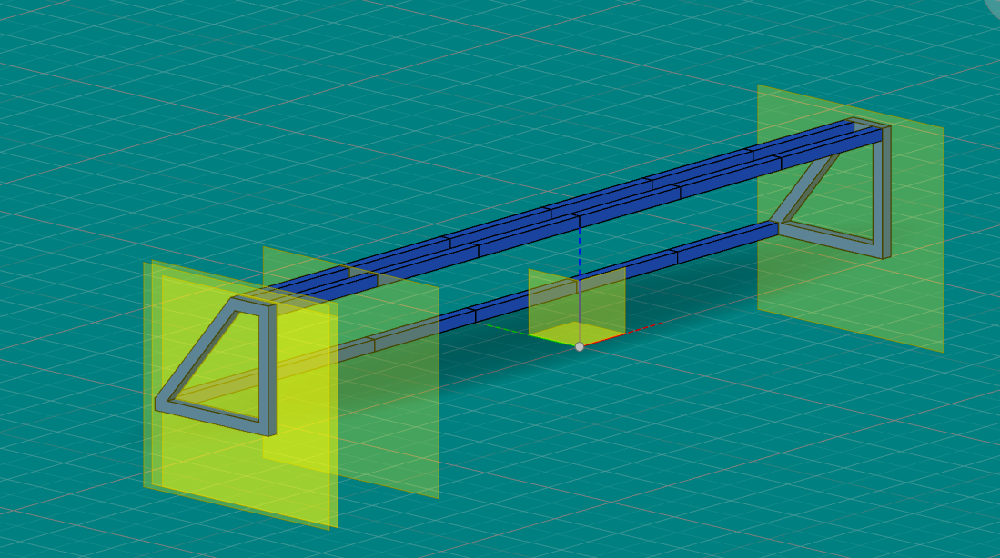
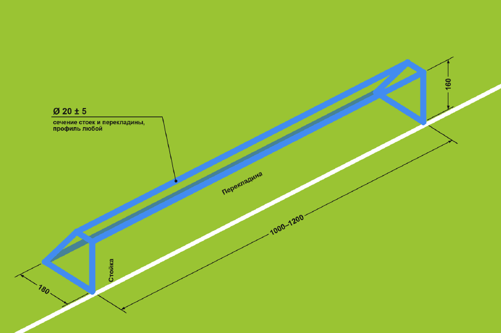

# Футбольные ворота для роботов — РобоФинист

Разборная 3D-модель футбольных ворот для соревнований **«РобоФинист»** в дисциплине **«Футбол управляемых роботов»**.

🔗 **Страница соревнований и регламент:** [robofinist.ru/event/info/competitions/id/1600](https://robofinist.ru/event/info/competitions/id/1600)



---

## О модели и габаритах

Модель спроектирована в **SolidCraft** по требованиям регламента и разделена на компактные детали с соединением **«шип-паз» на внутренних шпонках**. Все элементы печатаются **без поддержек** на стандартных 3D-принтерах со столом от `180 × 180 мм`.

* **Ширина:** `1100 мм` *(допуск регламента: `1000–1200 мм`)*
* **Высота:** `160 мм`
* **Глубина:** `180 мм`
* **Сечение стоек и перекладин:** `20 ± 5 мм` *(квадратный профиль)*

<details>
<summary>Чертёж из регламента (soccer_scheme.png)</summary>



</details>

---

## Два варианта профиля

В репозитории доступны **две независимые версии** ворот:

| Версия | Сечение | Паз | Шпонка (`Pin`) | Особенности |
| :--- | :---: | :---: | :---: | :--- |
| **`15mm`** | `15 × 15 мм` | `8.4 × 8.4 × 10 мм` | `8.0 × 8.0 × 19 мм` | Экономия **~40–44%** пластика и времени печати |
| **`20mm`** | `20 × 20 мм` | `11.4 × 11.4 × 11 мм` | `11.0 × 11.0 × 21 мм` | Усиленная конструкция для тяжёлых роботов |

> **Важно:** детали и шпонки от версий `15mm` и `20mm` **несовместимы** между собой. Используйте файлы из одной выбранной папки.

---

## Структура репозитория

```text
.
├── robot_soccer_goal_15mm_modular/        # STL-файлы для печати (профиль 15×15 мм)
│   ├── LeftFrame.stl                      #   Левая боковина (1 шт.)
│   ├── RightFrame.stl                     #   Правая боковина (1 шт.)
│   ├── FrontBar.stl                       #   Сегмент перекладины (18 шт.)
│   └── Pin.stl                            #   Соединительная шпонка (21 шт.)
├── robot_soccer_goal_15mm_modular.3mf     # Сборка в 3MF (15×15 мм)
├── robot_soccer_goal_15mm_modular.json    # Параметрический скрипт SolidCraft (15×15 мм)
├── robot_soccer_goal_15mm_modular.solidcraft
│
├── robot_soccer_goal_20mm_modular/        # STL-файлы для печати (профиль 20×20 мм)
│   ├── LeftFrame.stl                      #   Левая боковина (1 шт.)
│   ├── RightFrame.stl                     #   Правая боковина (1 шт.)
│   ├── FrontBar.stl                       #   Сегмент перекладины (18 шт.)
│   └── Pin.stl                            #   Соединительная шпонка (21 шт.)
├── robot_soccer_goal_20mm_modular.3mf     # Сборка в 3MF (20×20 мм)
├── robot_soccer_goal_20mm_modular.json    # Параметрический скрипт SolidCraft (20×20 мм)
├── robot_soccer_goal_20mm_modular.solidcraft
│
├── assembly_diagram.png                   # Схема сборки (PNG)
├── assembly_diagram.svg                   # Схема сборки (вектор SVG)
├── soccer_scheme.png                      # Исходный чертёж из регламента
└── img1.png                               # Рендер / превью модели
